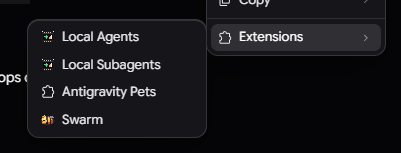
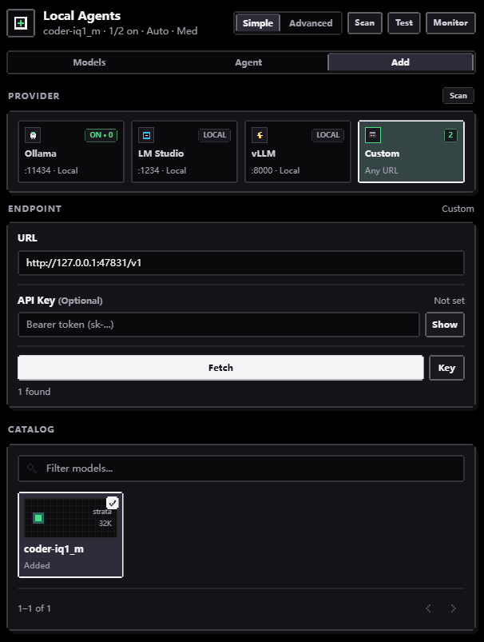
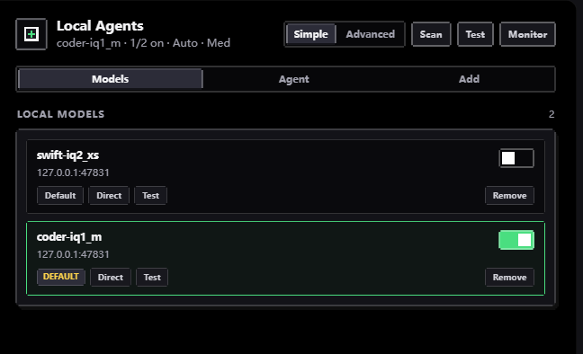
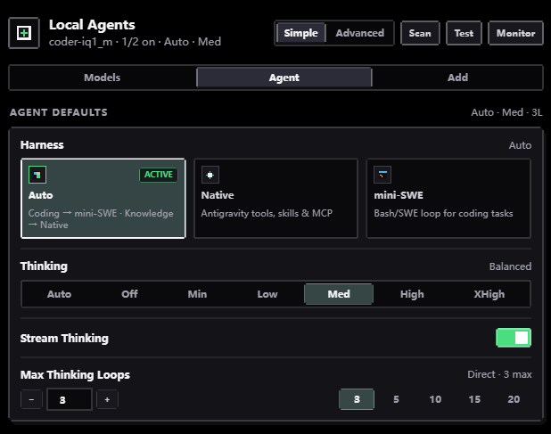
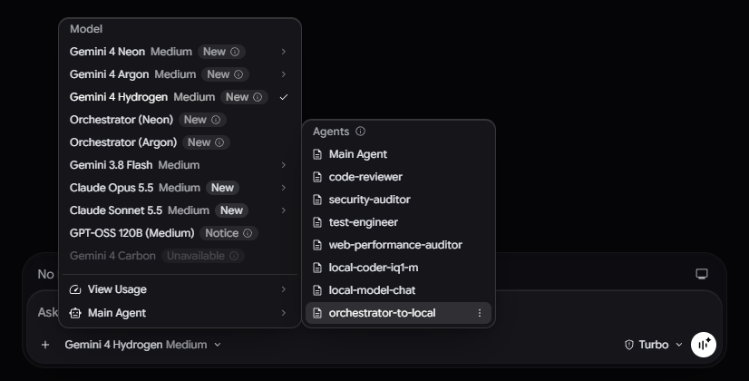
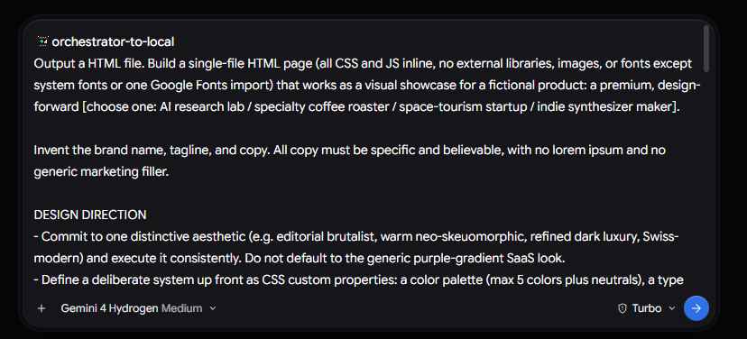
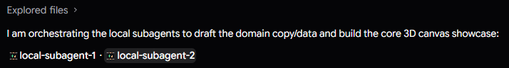
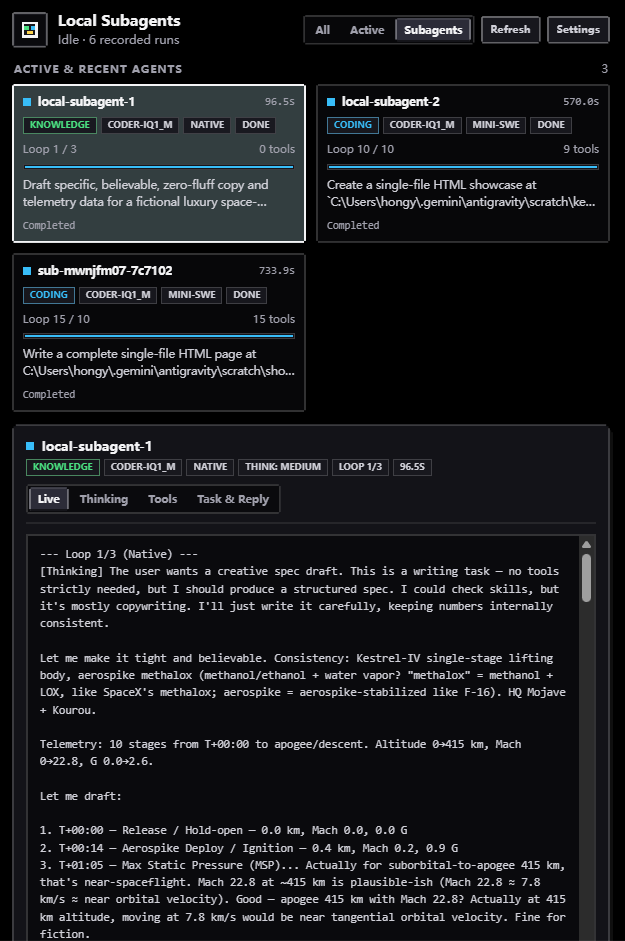
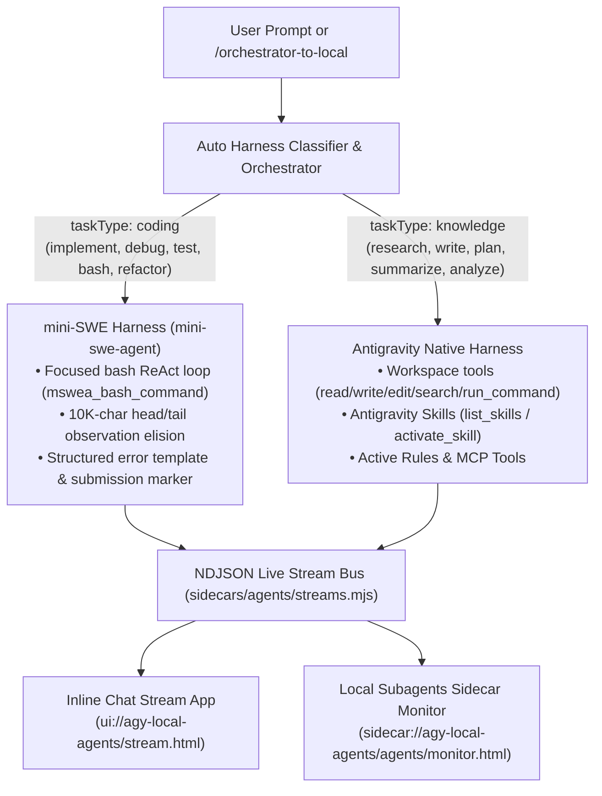

<p align="center">
  
</p>

<h1 align="center">Antigravity Local Agents</h1>

<p align="center">
  <strong>Your local &amp; OpenAI-compatible models as first-class agents, subagents, and orchestrated swarms inside Google Antigravity.</strong><br>
  Auto harness routing (<code>mini-SWE</code> for coding · <code>Native</code> for knowledge work), Gemini-to-local multi-subagent orchestration, live inline token &amp; thinking streams, and a dual-view pixel-art sidecar command center.
</p>

<p align="center">
  <a href="#one-prompt-agent-install"></a>
  <a href="#installation"></a>
  <a href="#auto-agent-harness-routing"></a>
  <a href="#verification--testing"></a>
  <a href="#credits--acknowledgements"></a>
</p>

<p align="center">
  <a href="#one-prompt-agent-install"><strong>One-Prompt Agent Install</strong></a> ·
  <a href="#quick-links">Quick Links</a> ·
  <a href="#what-you-can-do">Key Features</a> ·
  <a href="#visual-tour--screenshots">Screenshots</a> ·
  <a href="#everything-bundled-in-this-plugin">Bundled Skills &amp; Agents</a> ·
  <a href="#auto-agent-harness-routing">Architecture</a> ·
  <a href="#credits--acknowledgements">Credits</a>
</p>

---

**Antigravity Local Agents (`agy-local-agents`)** is an all-in-one, zero-dependency plugin for **Google Antigravity** that bridges local and custom OpenAI-compatible inference servers (**Ollama**, **LM Studio**, **vLLM**, **llama.cpp**, **OpenRouter**, **Groq**, **Together**, **DeepSeek**, **OpenAI**, or any `/v1` endpoint) directly into Antigravity's native agent, subagent, skill, and sidecar ecosystem.

Unlike raw proxy patches that modify Antigravity application binaries, `agy-local-agents` runs purely through Antigravity's first-party customization architecture (**Skills + Agents + MCP Server + Hooks + Sidecar Web UI**)—preserving native stability across IDE updates while adding intelligent **Auto Harness Routing** (`mini-SWE` vs. `Native`), **Gemini-to-Local Multi-Subagent Orchestration**, and **Real-Time Thinking & Tool Streaming**.

> [!TIP]
> **Install on any device in 10 seconds:** Copy the single prompt in [One-Prompt Agent Install](#one-prompt-agent-install) below (or point your agent to [`AGENT_INSTRUCTIONS.md`](AGENT_INSTRUCTIONS.md)) and let your Antigravity agent install, verify, and open the plugin for you automatically.

---

## Quick Links

| Get Started | Orchestrate & Configure | Reference & Architecture |
| --- | --- | --- |
| [One-Prompt Agent Install](#one-prompt-agent-install) | [Gemini-to-Local Orchestrator (`orchestrator-to-local`)](#3-gemini-to-local-orchestration-orchestrator-to-local) | [Everything Bundled in This Plugin](#everything-bundled-in-this-plugin) |
| [Manual Installation (Windows / macOS / Linux)](#manual-installation) | [Auto Agent Harness Routing (`mini-SWE` vs. `Native`)](#2-auto-agent-harness-routing-auto-default) | [MCP Server Tools & Stream App](#3-bundled-mcp-server-agy-local-agents) |
| [Add Your First Local Model](#1-dual-view-pixel-art-sidecar-ui-local-agents--local-subagents) | [Thinking Levels & Loop Budgets](#5-fine-grained-thinking-levels--loop-budgets) | [CLI & Python Antigravity SDK Runners](#6-cli--python-antigravity-sdk-runners) |
| [`AGENT_INSTRUCTIONS.md`](AGENT_INSTRUCTIONS.md) | [Hybrid Cloud Architect + Local Builder/Critic](#6-hybrid-cloud-architect--local-buildercritic-verification) | [Credits & Upstream Citations](#credits--acknowledgements) |

---

## One-Prompt Agent Install

Paste this single prompt into your **Google Antigravity** chat on any machine (Windows, macOS, or Linux). Your agent will read [`AGENT_INSTRUCTIONS.md`](AGENT_INSTRUCTIONS.md), clone the plugin into `~/.gemini/config/plugins/agy-local-agents`, run the self-verification suite, and surface one-click UI pills to open the panels:

```text
Please install the agy-local-agents plugin from https://github.com/hongyaok/agy-local-agents.git by reading and following https://raw.githubusercontent.com/hongyaok/agy-local-agents/main/AGENT_INSTRUCTIONS.md
```

### Manual Installation

If you prefer installing from a terminal yourself:

#### Windows (PowerShell)

```powershell
$pluginDir = "$HOME\.gemini\config\plugins\agy-local-agents"
git clone https://github.com/hongyaok/agy-local-agents.git $pluginDir
cd $pluginDir
node --test tests/smoke.test.mjs
```

#### macOS / Linux (Bash / Zsh)

```bash
PLUGIN_DIR="$HOME/.gemini/config/plugins/agy-local-agents"
git clone https://github.com/hongyaok/agy-local-agents.git "$PLUGIN_DIR"
cd "$PLUGIN_DIR"
node --test tests/smoke.test.mjs
```

Once cloned, open the plugin in Antigravity via the **Extensions** menu (**Local Agents** / **Local Subagents**) or ask your agent to display `[Antigravity Local Agents](customization://agy-local-agents)`.

---

## What You Can Do

| Capability | Included in `agy-local-agents` |
| --- | --- |
| **Dual Sidecar Panels in `Extensions`** | Registers two auxiliary-pane views: **Local Agents** (provider discovery, model manager, harness & thinking controls) and **Local Subagents** (live multi-subagent telemetry monitor). |
| **Auto Agent Harness Routing (`auto`)** | Automatically classifies tasks and subtasks: **Coding tasks** route to **`mini-SWE`** (`mini-swe-agent` bash/ReAct engineering loop); **Knowledge tasks** route to **Antigravity `Native`** (full workspace tools, skills, rules, and MCP access). |
| **Gemini-to-Local Orchestration** | Select `orchestrator-to-local` from the **Main Agent** dropdown (or run `/orchestrator-to-local`) to use a frontier Gemini model as lead architect that decomposes complex tasks, assigns `coding` vs. `knowledge` harnesses and loop budgets, spawns parallel local subagents, and verifies output. |
| **Dynamic Main Agent Picker Sync** | Every enabled local model automatically appears in Antigravity's **Main Agent** picker as `local-<model-slug>` (e.g. `local-coder-iq1-m`), alongside `local-model-chat`, `orchestrator-to-local`, and `local-model-worker`. |
| **Live Inline Chat & Monitor Streaming** | Eliminates opaque `"working..."` spinners. Streams real-time `[Thinking]` traces, tool executions, loop counters, and response tokens inline via an embedded MCP App (`ui://agy-local-agents/stream.html`) and NDJSON event bus. |
| **One-Click Subagent Monitor Pills** | When spawning multiple local subagents (`local-subagent-1`, `local-subagent-2`, …), clickable pills are emitted directly in chat to inspect each subagent's live thinking loop, tool calls, and reply in the **Local Subagents** panel. |
| **Provider Presets & Port Scanner** | Built-in presets and one-click local port scanner for **Ollama** (`:11434`), **LM Studio** (`:1234`), **vLLM** (`:8000`), **OpenAI**, **OpenRouter**, **Groq**, **Together**, **DeepSeek**, and **Custom** OpenAI-compatible URLs. |
| **Thinking Effort & Loop Budgets** | Configure thinking effort (`Auto`, `Off`, `Minimal`, `Low`, `Medium`, `High`, `Extra High`) with automatic fallback handling across `reasoning_effort`, `thinking`, and `<think>` blocks, plus configurable `Max Thinking Loops` (`1–50`). |
| **Hybrid Cloud Architect + Local Critic** | Zero-body AST skeleton extraction (`0` implementation bytes sent to cloud architect) paired with multi-candidate (`minimal` vs. `defensive`) local builders and a shuffled blind local critic. |
| **Loopback Auth Proxy & Python SDK** | Local loopback proxy injects `Authorization: Bearer` headers for API-key-protected providers and generates copy-ready Python `LocalOpenAIAgentConfig(...).lightweight()` scripts. |

---

## Visual Tour & Screenshots

### 1. Dual-View Pixel-Art Sidecar UI (`Local Agents` & `Local Subagents`)

Both sidecar panels are accessible anytime from the **Extensions** menu in Antigravity:

<p align="center">
  
</p>

- **Add & Discover Providers (`Add` Tab)**: Scan local ports or enter any OpenAI-compatible `/v1` endpoint (Ollama, LM Studio, vLLM, llama.cpp, or custom servers), optionally attach a Bearer API key, fetch the live model catalog, and add models with a click.
- **Manage Local Models (`Models` Tab)**: Toggle models on/off, designate your **DEFAULT** local model, enable **Direct** chat interception, test latency, or remove endpoints.

| Add & Discover Models (`Add` Tab) | Manage Added Models (`Models` Tab) |
| :---: | :---: |
|  |  |

---

### 2. Auto Agent Harness Routing (`auto` Default) & Thinking Controls

In the **Agent** tab of **Local Agents**, configure how your local models execute tasks:

<p align="center">
  
</p>

- **`Auto` Harness (Default)**:
  - **Coding tasks** (implementing features, refactoring, debugging, running tests, shell/build workflows) automatically route to **`mini-SWE`** (`mini-swe-agent`), using a focused bash/ReAct software-engineering loop with 10,000-character head/tail observation elision and structured error recovery.
  - **Knowledge work** (research, architecture specs, copywriting, summarization, Q&A, planning) automatically routes to **Antigravity `Native`**, equipping the local model with native workspace tools (`read_file`, `write_file`, `edit_file`, `list_dir`, `search_files`, `run_command`), installed skills (`list_skills`, `activate_skill`), active rules, and MCP tools.
- **`Native` Harness**: Forces the Antigravity Native tool/skill/MCP harness for all requests.
- **`mini-SWE` Harness**: Forces the `mini-swe-agent` bash loop for all requests (also triggerable on-demand via `@mini-swe` or `/mini-swe` in chat).
- **Thinking & Loop Budgets**: Set global or per-model thinking effort (`Auto`, `Off`, `Min`, `Low`, `Med`, `High`, `XHigh`), toggle **Stream Thinking**, and set **Max Thinking Loops** (`1–50`).

---

### 3. Native Main Agent Picker Integration

Every model you enable is dynamically synced into Antigravity's **Main Agent** dropdown alongside the core orchestrator and chat bridges:

<p align="center">
  
</p>

---

### 4. Gemini-to-Local Orchestration & Live Multi-Subagent Monitoring

Select **`orchestrator-to-local`** (or invoke `/orchestrator-to-local`) to pair a frontier model (such as Gemini) as lead planner with your local models as parallel execution subagents:

<p align="center">
  
</p>

When `orchestrator-to-local` delegates across multiple local subagents, it classifies each subtask (`KNOWLEDGE` → `NATIVE` vs. `CODING` → `MINI-SWE`), assigns tailored loop budgets (`maxThinkingLoops`), and emits clickable monitor pills directly in chat:

<p align="center">
  
</p>

Clicking any pill (or opening **Extensions → Local Subagents**) launches the **Local Subagents Monitor**, where you can watch every active and recent subagent's harness badge, loop progress bar, tool count, and live streaming **`[Thinking]`**, **`Tools`**, and **`Task & Reply`** traces in real time:

<p align="center">
  
</p>

---

## Everything Bundled in This Plugin

`agy-local-agents` is a self-contained Antigravity plugin (no external sub-plugins or npm packages required). Here is the complete inventory of what is bundled:

### 1. Bundled Skills (4)

| Skill Name | Path | Trigger / Purpose |
| --- | --- | --- |
| **`agy-local-agents`** | [`skills/agy-local-agents/SKILL.md`](skills/agy-local-agents/SKILL.md) | Core guide for managing local models, Auto harness routing (`mini-SWE` vs. `Native`), live chat streaming, and opening the sidecar panels. |
| **`local-models`** | [`skills/local-models/SKILL.md`](skills/local-models/SKILL.md) | Call, chat with, or delegate coding, review, and knowledge tasks to configured OpenAI-compatible models; includes the full CLI engine [`local-model.mjs`](skills/local-models/scripts/local-model.mjs). |
| **`local-subagent`** | [`skills/local-subagent/SKILL.md`](skills/local-subagent/SKILL.md) | Triggered by `/local-subagent` or delegation requests; runs an autonomous local subagent with full workspace/skill/MCP access and live streaming. |
| **`orchestrator-to-local`** | [`skills/orchestrator-to-local/SKILL.md`](skills/orchestrator-to-local/SKILL.md) | Triggered by `/orchestrator-to-local`; uses the active Gemini model as lead orchestrator to decompose work, classify coding vs. knowledge subtasks, size thinking loops, and spawn monitored local subagents. |

### 2. Bundled & Dynamic Agents (`agents/`)

| Agent Name | Role (`mainAgent` / `subagent`) | Description |
| --- | --- | --- |
| **`orchestrator-to-local`** | `mainAgent: true`, `subagent: true` | Frontier Gemini orchestrator that plans multi-step work, classifies `coding` (`mini-SWE`) vs. `knowledge` (`Native`) subtasks, sets `maxThinkingLoops`, delegates to local subagents, and verifies output. |
| **`local-model-chat`** | `mainAgent: true`, `subagent: true` | Direct streaming chat interface to your default configured local/OpenAI-compatible model with verbose `[Thinking]` trace display. |
| **`local-model-worker`** | `mainAgent: false`, `subagent: true` | Specialized background execution subagent that lists available local models, runs autonomous subtasks, or executes hybrid builder/critic verification loops. |
| **`local-<model-slug>`** *(Auto-synced)* | `mainAgent: true`, `subagent: true` | Dynamically generated per enabled model (e.g., `local-coder-iq1-m`) so you can pick any added local model directly from the **Main Agent** dropdown. |

### 3. Bundled MCP Server (`agy-local-agents`)

Configured in [`mcp_config.json`](mcp_config.json) and powered by [`mcp/server.mjs`](mcp/server.mjs), providing **11 tools** plus an interactive MCP App resource (`ui://agy-local-agents/stream.html` built from [`mcp/stream-app.html`](mcp/stream-app.html)):

| MCP Tool | Description |
| --- | --- |
| `agy_local_list` | List all configured OpenAI-compatible models, endpoints, active defaults, and harness/thinking settings. |
| `agy_local_discover` | Discover available models from a preset (`ollama`, `lmstudio`, `vllm`, `openai`, `openrouter`, `groq`, `together`, `deepseek`, `custom`) or `/v1` base URL. |
| `agy_local_add` | Add one or all discovered models to `agy-local-agents`, sync `~/.gemini/antigravity/custom_models.json`, and generate `agents/local-<model>.md`. |
| `agy_local_remove` | Remove an added model by ID and clean up its managed agent entry. |
| `agy_local_chat` | Send a prompt or task to a local model with Auto harness routing (`taskType: "coding" \| "knowledge"`), thinking trace extraction, and live inline UI streaming. |
| `agy_local_subagent` | Spawn an autonomous local model subagent with configurable `taskType`, `harness`, `thinkingLevel`, `maxThinkingLoops`, and `runId` telemetry recording. |
| `agy_local_stream_watch` | Stream live tokens, `[Thinking]` steps, and tool calls inline in chat for one or more background `runId`s. |
| `agy_local_stream_poll` | Poll incremental NDJSON stream events and status for active or completed subagent runs. |
| `agy_local_agent_settings` | Inspect or update global defaults (`harness`, `thinkingLevel`, `verbose`, `uiMode`, `maxThinkingLoops`). |
| `agy_local_direct_chat` | Configure direct-chat interception mode and target local model. |
| `agy_local_hybrid_orchestrate` | Run the privacy-preserving Hybrid Cloud Architect (0-body AST skeleton) + Multi-Candidate Local Builder & Blind Critic loop on a target file. |

### 4. `PreInvocation` Direct-Chat Hook (`hooks.json`)

Configured in [`hooks.json`](hooks.json) ([`mcp/direct-chat-hook.mjs`](mcp/direct-chat-hook.mjs)):
- Supports explicit prefixes right in chat: `@local <prompt>`, `/local <prompt>`, `/local-subagent <task>`, `@mini-swe <coding-task>`, `/mini-swe <coding-task>`, or `@<model-id> <prompt>`.
- Also supports global **Direct** mode (toggled from the sidecar's `Models` tab) to route every turn directly through your chosen local model.

### 5. Dual-View Sidecar Web Server (`sidecars/agents/`)

Configured in [`sidecars/agents/sidecar.json`](sidecars/agents/sidecar.json) and served by [`sidecars/agents/main.mjs`](sidecars/agents/main.mjs):
- **`Local Agents` (`/` → [`index.html`](sidecars/agents/index.html))**: Features both a streamlined **Simple** view (`Models` / `Agent` / `Add` tabs) and a power-user **Advanced** view (provider catalog, per-model harness/thinking overrides, Python SDK snippet generator, and live activity log).
- **`Local Subagents` (`/monitor.html` → [`monitor.html`](sidecars/agents/monitor.html))**: Dedicated multi-agent telemetry dashboard displaying active & historical runs, loop progress bars, tool counters, and tabbed `Live` / `Thinking` / `Tools` / `Task & Reply` inspectors.
- **Loopback Auth Proxy**: Automatically proxies API-key-protected endpoints on `127.0.0.1` so local SDK scripts and subagents never expose raw credentials in prompts.

### 6. CLI & Python Antigravity SDK Runners

- **Node.js CLI ([`skills/local-models/scripts/local-model.mjs`](skills/local-models/scripts/local-model.mjs))**:
  ```bash
  node skills/local-models/scripts/local-model.mjs list
  node skills/local-models/scripts/local-model.mjs discover --preset ollama
  node skills/local-models/scripts/local-model.mjs add --preset ollama --all --set-default
  node skills/local-models/scripts/local-model.mjs chat --task-type knowledge --prompt "Summarize this repo"
  node skills/local-models/scripts/local-model.mjs subagent --run-id local-subagent-1 --task-type coding --max-loops 10 --task "Run tests and fix failures"
  ```
- **Antigravity Python SDK Runner ([`sdk/local_openai_agent.py`](sdk/local_openai_agent.py))**:
  Runs any added model through Google Antigravity's official `LocalOpenAIAgentConfig(model=..., base_url=...).lightweight()` SDK API.
- **Hybrid Orchestrator SDK Runner ([`sdk/hybrid_orchestrator_runner.py`](sdk/hybrid_orchestrator_runner.py))**:
  Extracts a zero-body public AST skeleton for the Cloud Chief Architect and runs `minimal` + `defensive` local builders judged by a blind shuffled local critic.

---

## Auto Agent Harness Routing



---

## Verification & Testing

`agy-local-agents` ships with an end-to-end, zero-dependency test suite ([`tests/smoke.test.mjs`](tests/smoke.test.mjs)) using local mock OpenAI servers to verify discovery, `custom_models.json` migration, dynamic agent markdown generation, Auto harness classification, `mini-swe-agent` observation elision, MCP stdio tools, CLI SSE streaming, and sidecar HTTP endpoints:

```bash
node --test tests/smoke.test.mjs
```

---

## Credits & Acknowledgements

`agy-local-agents` builds upon and adapts ideas, protocols, and design patterns from the following open-source projects and official SDKs:

1. **[`vahapogut/antigravity-add-model`](https://github.com/vahapogut/antigravity-add-model)** by **[@vahapogut](https://github.com/vahapogut)**
   - Inspired the OpenAI-compatible provider preset catalog (Ollama, LM Studio, vLLM, OpenRouter, Groq, Together, DeepSeek, Custom), model metadata discovery, `~/.gemini/antigravity/custom_models.json` synchronization, and README structure.
2. **[`SWE-agent/mini-swe-agent`](https://github.com/SWE-agent/mini-swe-agent)** by **Princeton NLP & the SWE-agent Team**
   - Inspired the **`mini-SWE` (`mini-swe-agent`)** coding harness in [`sidecars/agents/harnesses.mjs`](sidecars/agents/harnesses.mjs), including the single-step bash ReAct execution loop (`mswea_bash_command`), the `COMPLETE_TASK_AND_SUBMIT_FINAL_OUTPUT` submission marker protocol, 10,000-character head/tail observation elision (`MINI_SWE_MAX_OBSERVATION_CHARS`), and structured command error formatting templates.
3. **[`google-gemma/cookbook` — `antigravity-hybrid-orchestrator`](https://github.com/google-gemma/cookbook/tree/main/apps/antigravity-hybrid-orchestrator)** by **Google Gemma Cookbook**
   - Basis for the **Hybrid Cloud Architect + Local Builder/Critic** verification workflow in [`sdk/hybrid_orchestrator_runner.py`](sdk/hybrid_orchestrator_runner.py) and `agy_local_hybrid_orchestrate` in [`sidecars/agents/store.mjs`](sidecars/agents/store.mjs)—extracting zero-body public AST skeletons for the Cloud Architect while keeping full source code local across `minimal` and `defensive` builders and a blind shuffled local critic.
4. **[Google Antigravity Python SDK (`LocalOpenAIAgentConfig`)](https://antigravity.google/docs/sdk/local-models/)**
   - Official `LocalOpenAIAgentConfig(model=..., base_url=...).lightweight()` pattern integrated into [`sdk/local_openai_agent.py`](sdk/local_openai_agent.py) and the sidecar's interactive SDK snippet generator.
5. **[Petdex / Antigravity Pets (`agy-pets`)](https://petdex.dev)**
   - Inspired the retro pixel-art sidecar aesthetic (`Pixelify Sans` and `Silkscreen` pixel typography, compact status badges, and auxiliary pane integration).

---

<p align="center">
  <a href="#antigravity-local-agents">↑ Back to top</a>
</p>
